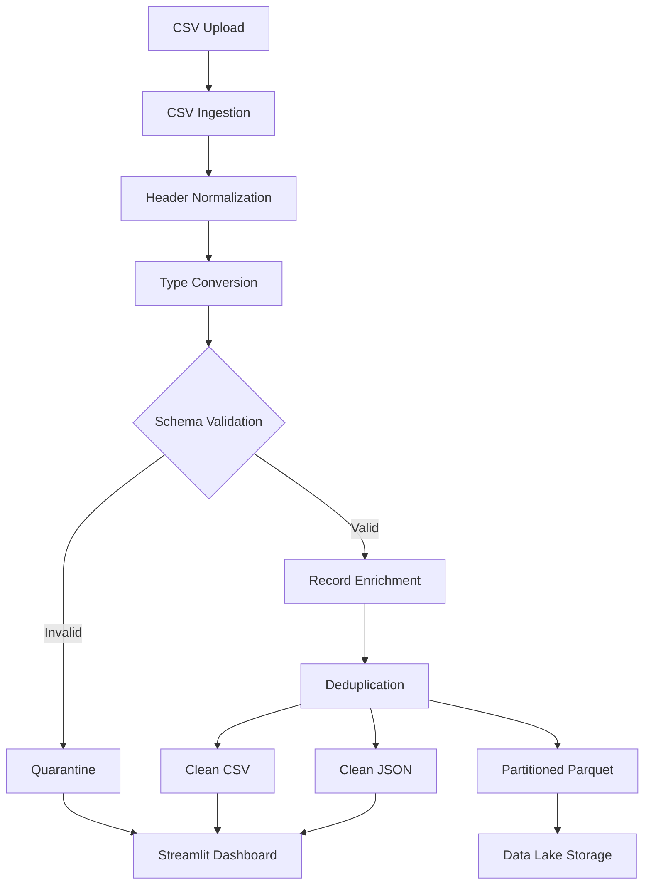

# 🗄️ CSV Cleaner & Parquet Data Lake

### A Modular Python Data Engineering Pipeline for Data Ingestion, Validation, Cleaning & Storage

Transform messy CSV files into clean, validated, deduplicated, and analytics-ready datasets with an interactive web interface.

Built with **Python, Pandas, Streamlit, PyArrow, and YAML**, this project demonstrates an end-to-end data engineering workflow using modular programming principles.

<p align="center">

  **Messy CSV → Schema Validation → Data Cleaning → Deduplication → JSON & Parquet Lake**

</p>

---

## 📌 Project Overview

Public datasets often contain inconsistent column names, missing values, incorrect data types, duplicate records, and malformed CSV rows.

This project provides a modular solution to ingest CSV data, standardize its structure, validate data quality, isolate rejected records, and export clean datasets in multiple formats.

Users can upload CSV files through an interactive web interface, inspect cleaned JSON records, review rejected rows, and download the processed results.

### 🎯 Project Objectives

- Build a reusable, modular data ingestion pipeline.
- Normalize inconsistent CSV column names.
- Convert values into schema-defined data types.
- Validate required fields and data quality rules.
- Generate deterministic record identifiers.
- Detect and remove duplicate records.
- Quarantine invalid records with error descriptions.
- Export clean datasets to JSON, CSV, and Parquet.
- Support partitioned Parquet storage.
- Provide an interactive interface for exploring processed data.

---

## ✨ Key Features

| Feature | Description |
|---|---|
| 📂 CSV Ingestion | Upload CSV files through the web interface. |
| 🧹 Header Normalization | Standardize column names using lowercase snake_case. |
| 🔄 Type Conversion | Convert strings into integers, floats, booleans, and datetimes. |
| 🛡️ Schema Validation | Enforce configurable required-field and nullability rules. |
| 🆔 Record Identification | Generate deterministic SHA-256-based record IDs. |
| ♻️ Deduplication | Remove duplicate records using configurable keys. |
| 🚧 Error Quarantine | Preserve rejected records and their error messages. |
| 📦 JSON Export | Download structured, human-readable JSON records. |
| 📊 CSV Export | Export cleaned records for spreadsheet and analytics tools. |
| 🗃️ Parquet Storage | Store cleaned data in column-oriented Parquet format. |
| 🧩 Partitioned Datasets | Organize Parquet output by a selected column. |
| 🔎 Interactive Search | Search and inspect cleaned JSON records in the UI. |
| ⚙️ YAML Configuration | Change schema rules without modifying pipeline logic. |
| 🧪 Unit Testing | Test core transformation and validation behavior. |

---

## 🏗️ System Architecture



### Processing Workflow

1. **Ingestion:** Read the uploaded CSV and preserve raw field values for controlled conversion.
2. **Normalization:** Standardize column names and detect naming collisions.
3. **Transformation:** Apply the types specified in the schema configuration.
4. **Validation:** Check required fields and reject records that violate configured rules.
5. **Enrichment:** Generate record IDs and add UTC processing timestamps and project metadata.
6. **Deduplication:** Remove repeated records according to the configured deduplication key.
7. **Storage:** Export accepted records to JSON, CSV, and Parquet.
8. **Quarantine:** Save invalid records with error messages for inspection.

---

## 🛠️ Technology Stack

| Technology | Purpose |
|---|---|
| Python | Core programming language |
| Pandas | Tabular data processing and transformation |
| Streamlit | Interactive web dashboard |
| PyArrow | Parquet serialization and storage |
| PyYAML | Schema and configuration management |
| `hashlib` | Deterministic SHA-256 record identifiers |
| `unittest` | Automated unit testing |
| JSON | Structured data exchange |
| CSV | Source ingestion and quarantine format |
| Apache Parquet | Analytics-oriented columnar storage |

---

## 📁 Project Structure

```text
csv-parquet-lake/
│
├── app.py                     # Streamlit web application
├── main.py                    # Optional CLI entry point, if included
├── requirements.txt            # Python dependencies
├── README.md                  # Project documentation
├── .gitignore
│
├── config/
│   └── schema.yaml            # Schema and validation rules
│
├── src/
│   ├── __init__.py
│   ├── config.py               # Configuration loading
│   ├── ingestion.py            # CSV ingestion
│   ├── transform.py             # Normalization and type conversion
│   ├── validation.py            # Data quality checks
│   ├── pipeline.py              # Pipeline orchestration
│   └── exporters.py              # JSON, CSV and Parquet exports
│
├── tests/
│   └── test_pipeline.py         # Unit tests
│
└── data/
    ├── input/                   # Uploaded/source CSV files
    ├── output/
    │   ├── cleaned.json
    │   ├── cleaned.csv
    │   └── parquet/             # Parquet dataset
    └── quarantine/
        └── bad_rows.csv         # Rejected records
```

*Note: The structure documents the modular application. Keep only files that actually exist in your repository; `main.py` is optional if you use Streamlit as the primary entry point.*

---

## 🚀 Getting Started

### 1. Clone the Repository

```bash
git clone YOUR_GITHUB_REPOSITORY_URL
cd csv-parquet-lake
```

Replace `YOUR_GITHUB_REPOSITORY_URL` with your repository's actual URL.

### 2. Create a Virtual Environment

**Windows — PowerShell**

```powershell
py -m venv .venv
.\.venv\Scripts\Activate.ps1
```

**Linux / macOS**

```bash
python3 -m venv .venv
source .venv/bin/activate
```

### 3. Install Dependencies

```bash
python -m pip install --upgrade pip
pip install -r requirements.txt
```

Ensure that `requirements.txt` contains the dependencies used by your current code, including Streamlit, Pandas, PyArrow, and PyYAML.

### 4. Launch the Application

```bash
streamlit run app.py
```

Open the local URL printed in your terminal, usually:

`http://localhost:8501`

### 5. Upload and Process a Dataset

1. Select a CSV file from your computer.
2. Review the source preview.
3. Verify that the schema configuration matches the dataset.
4. Choose an optional Parquet partition column.
5. Click **Clean and Validate CSV**.
6. Explore cleaned JSON records and processing statistics.
7. Download the cleaned JSON, cleaned CSV, or rejected rows.

---

## ⚙️ Schema Configuration

The pipeline uses YAML to define the expected structure of the dataset.

Example `config/schema.yaml`:

```yaml
project_title: "CSV Cleaner and Parquet Data Lake"

deduplicate_on:
  - record_id

columns:
  name:
    type: string
    nullable: false

  age:
    type: int
    nullable: false

  city:
    type: string
    nullable: false
```

### Supported Data Types

- `string`
- `int`
- `float`
- `bool`
- `datetime`

### Configuration Benefits

- Adapt the pipeline to different datasets.
- Define required and optional fields.
- Control type conversion and validation.
- Configure the deduplication strategy.
- Keep business rules separate from application logic.

---

## 📊 Example Input

A source CSV might contain inconsistent headers and invalid records:

```csv
 Name ,AGE, City
Alice,25,New York
Bob,32,London
Charlie,not-a-number,Berlin
Alice,25,New York
David,,Paris
Eve,29,
```

Potential issues include:

- Extra whitespace in column names.
- Inconsistent capitalization.
- Invalid integer values.
- Missing required values.
- Duplicate records.

The pipeline normalizes headers, converts values according to the schema, and separates accepted records from rejected rows.

---

## 📄 Example Cleaned JSON

```json
[
  {
    "name": "Alice",
    "age": 25,
    "city": "New York",
    "record_id": "generated_sha256_hash",
    "processed_at": "UTC_TIMESTAMP",
    "project": "CSV Cleaner and Parquet Data Lake"
  }
]
```

The hash and timestamp shown here are illustrative. Actual values are generated at runtime.

### Export Formats

**JSON:** Structured records for APIs and applications.

**CSV:** Clean tabular data for spreadsheets and downstream tools.

**Parquet:** Column-oriented storage for analytical workloads.

**Quarantine CSV:** Invalid source records accompanied by validation or conversion error messages.

---

## 🗃️ Parquet Data Lake

The pipeline supports writing Parquet datasets with an optional partition column.

For example, partitioning by `city` may produce a structure similar to:

```text
data/output/parquet/
├── city=London/
├── city=New York/
└── city=Paris/
```

The actual directory structure depends on the selected partition column and accepted data values.

### Why Parquet?

- Efficient columnar storage.
- Compression support.
- Suitable for analytical queries.
- Integrates with common data engineering and analytics tools.
- Supports partitioned datasets for organized data access.

---

## 🚧 Data Quality and Error Handling

Invalid records should not silently disappear.

The quarantine output preserves rejected data alongside an error description, helping users investigate the source of the issue.

Examples include:

- Missing required fields.
- Failed numeric conversions.
- Invalid boolean values.
- Invalid datetime values.
- Missing required schema columns.
- Ambiguous column names after normalization.

This approach makes the pipeline easier to debug and improves data traceability.

---

## 🧪 Testing

Run the unit tests from the project root:

```bash
python -m unittest discover -s tests -v
```

Tests can cover:

- Header normalization.
- Deterministic record ID generation.
- Numeric conversion.
- Boolean conversion.
- Required-field validation.
- Duplicate handling.
- Quarantine behavior.
- Parquet output integrity.

Only claim test coverage for cases that are implemented in the test suite.

---

## 🔐 Reliability and Design Considerations

- **Modular design:** Each module has a clearly defined responsibility.
- **Configurable validation:** Schema rules can be changed without rewriting the pipeline.
- **Deterministic identifiers:** Identical normalized source records generate the same ID.
- **Controlled conversion:** Invalid values are rejected instead of being silently coerced.
- **Quarantine support:** Bad rows remain available for investigation.
- **Separation of concerns:** Ingestion, transformation, validation, orchestration, UI, and export logic are separated.
- **Explicit schema:** The pipeline does not assume every incoming CSV is correctly structured.

For production deployments, additional safeguards may be appropriate, including upload-size limits, authentication, persistent job history, structured logging, schema versioning, and monitoring.

---

## 🔮 Future Enhancements

- [ ] Drag-and-drop multi-file uploads.
- [ ] Automatic schema suggestions.
- [ ] Interactive schema editor.
- [ ] Advanced validation rules and custom expressions.
- [ ] Downloadable Parquet archives.
- [ ] Batch processing for large datasets.
- [ ] Data profiling and quality reports.
- [ ] Processing history and audit logs.
- [ ] Cloud object storage integration.
- [ ] Apache Airflow orchestration.
- [ ] Docker-based deployment.
- [ ] Automated CI testing.

---

## 🎓 Skills Demonstrated

This project demonstrates practical knowledge of:

- Python modular programming.
- Data ingestion and preprocessing.
- Schema design and validation.
- Data type conversion.
- Data quality management.
- Deterministic hashing and deduplication.
- Error handling and quarantine workflows.
- JSON and CSV serialization.
- Parquet storage and partitioning.
- Interactive data applications.
- Automated testing.
- Reproducible data processing.

---

## 👨‍💻 Author

**Ayaz ul Haq**

Data Science | Machine Learning | AI Engineering | Data Engineering

- GitHub: https://github.com/aky-ds
- LinkedIn: https://www.linkedin.com/in/ayaz-ul-haq-9772862b2/

---

## 📜 License

Choose a license before distributing the project publicly. The MIT License is one option for an open-source educational project.

---

<p align="center">

**Built to transform messy data into clean, reliable, analytics-ready datasets.**

*CSV Ingestion • Data Quality • Modular Python • JSON • Parquet*

</p>
